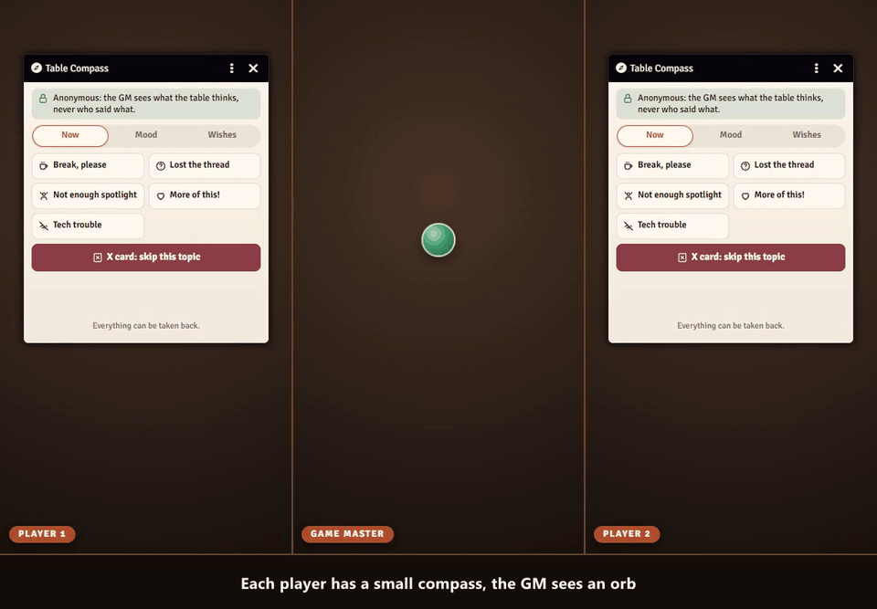

# Sephral’s Table Compass

**Is the pace too slow? Is the horror too much? Does somebody wish for a good fight? Players often feel it but rarely say it out loud. Table Compass lets them tell the GM anonymously, and the GM sees the mood of the table in one small window.**

## Highlights

* **Scales with fine in the middle:** pace, tension, roleplay, combat and challenge, and more if the GM likes: descriptions, humor, exploration, rules at the table.
* **Quick signals:** a break, lost the thread, not enough spotlight, more of this, tech trouble. And the X card, which reaches the GM at once.
* **Wishes for the next scenes:** combat, a puzzle, a character moment, a campfire, loot, intrigue and more. The GM can answer with "coming soon".
* **A small window for the GM:** the scales as balances, a compass rose and the history of the evening. Collapsed it becomes an orb that glows green, amber or red.
* **Scene check:** the GM asks "How was the scene?" and the players answer with a face in 30 seconds.
* **Feedback round:** at the end of the session the players rate the evening, name their highlight and what they want more or less of, and say it in their own words if they like.
* **Anonymous by design:** names are never shown or kept, results appear only from two votes on and with a short random delay, and free texts come back in a random order. Being anonymous makes honest feedback more likely.

## How it works

1. Enable the module.
2. Players open the compass from the token controls and say what they feel, whenever they feel it.
3. The GM keeps the small window or the orb in a corner and starts the feedback round at the end of the session.

## Good to know

A GM has to be online to receive the votes. What players say while no GM is there goes out as soon as one joins.

## Install

Search for **Table Compass** in Foundry's module browser or open the [package page](https://foundryvtt.com/packages/sephrals-table-compass).

Foundry VTT 13 and 14 · any game system · English and German

## Learn more

The scales, the signals, the anonymity and the settings are explained in the [manual](MANUAL.md). Questions or ideas? Join us on [Discord](https://discord.gg/7BjCgDYaBP). Looking for more? See [all modules by Sephral](https://github.com/Sephral).

## License

See [LICENSE.md](LICENSE.md).
